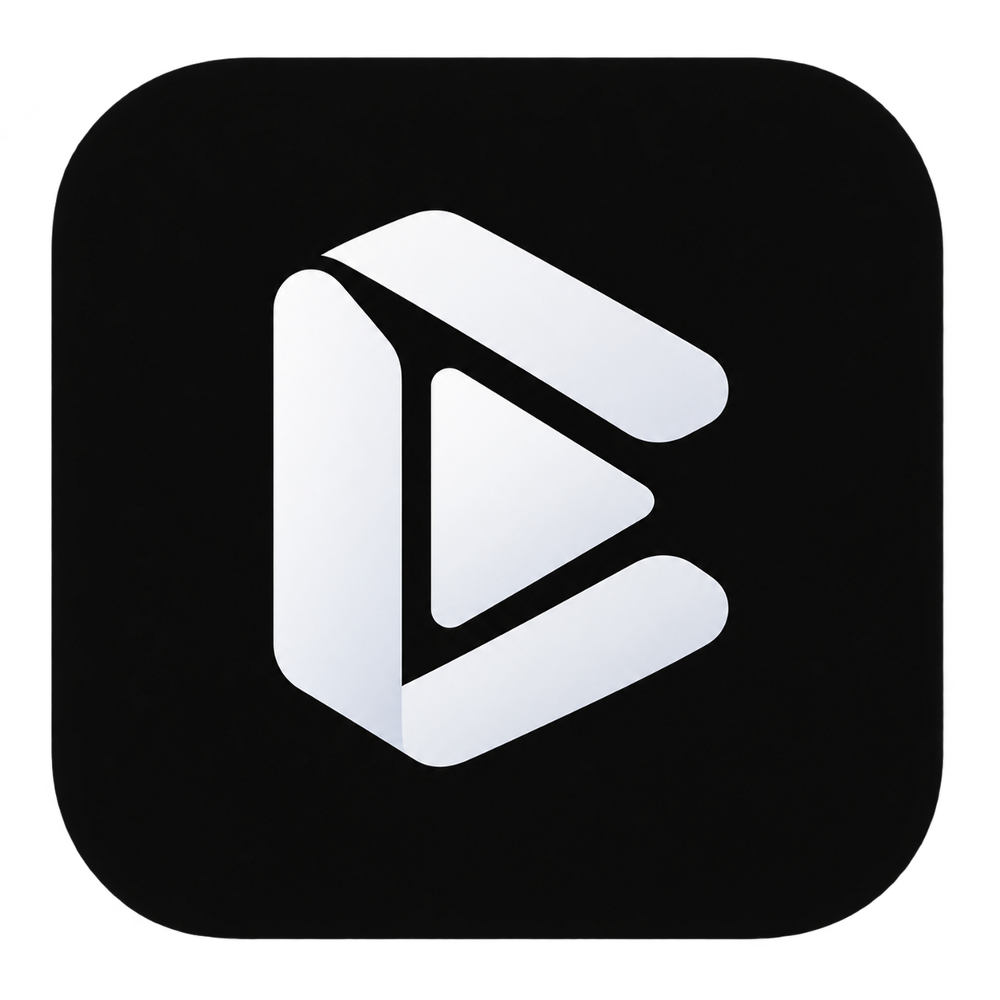
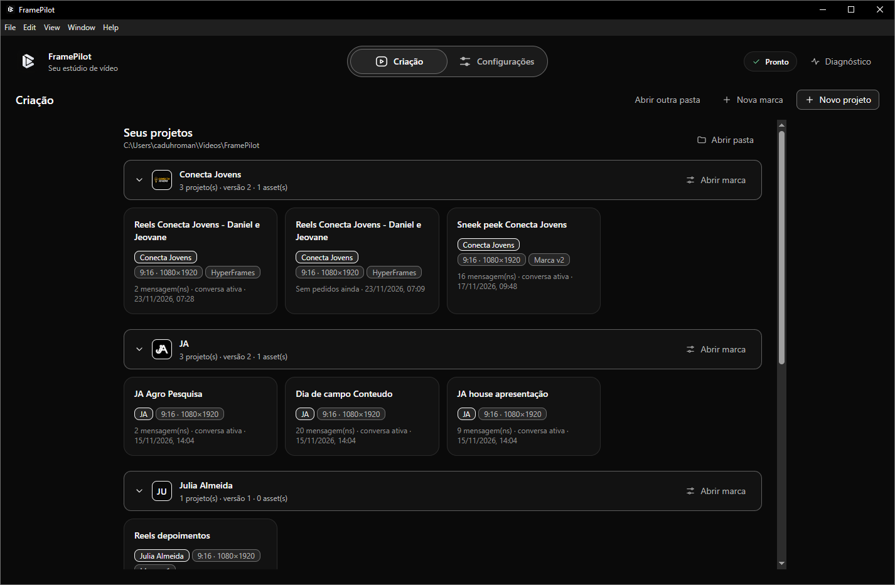
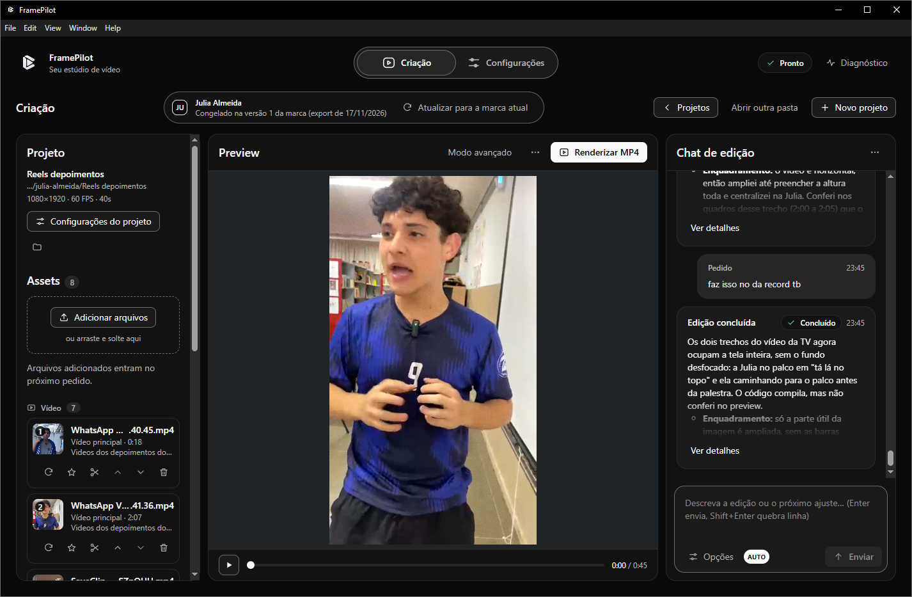
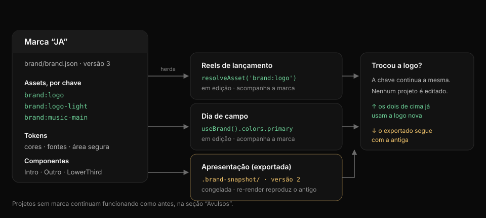
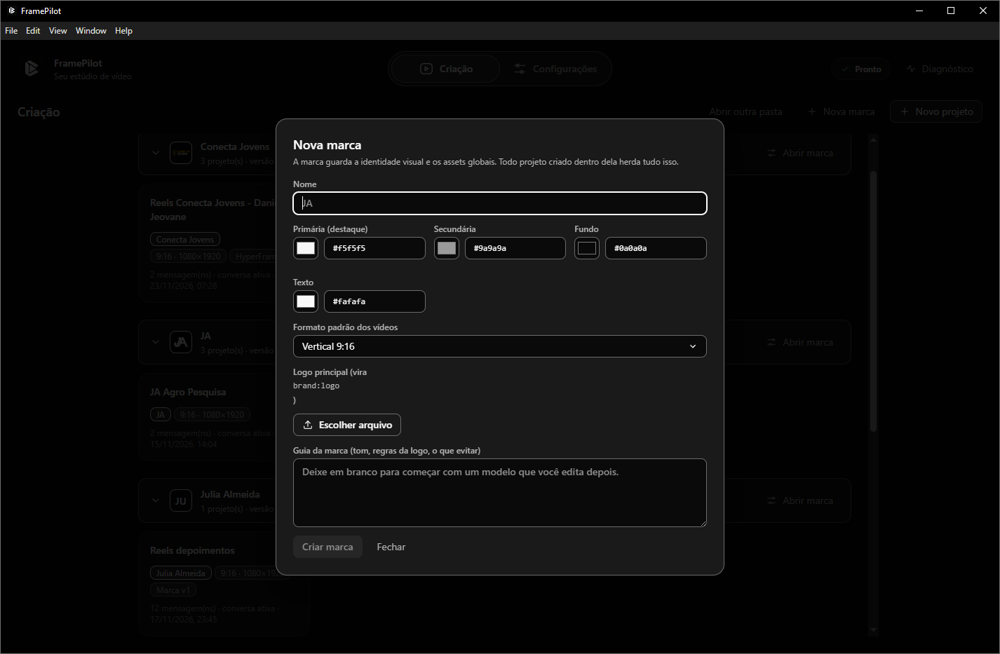

<div align="center">



# FramePilot

### Seu estúdio de vídeo, movido a conversa.

**Você descreve. A IA edita. Você assiste e ajusta.**

Um editor de vídeo para Windows onde a edição acontece no chat: junte seus arquivos,
descreva o vídeo que quer, e a IA faz os cortes, as legendas, a trilha e as animações.
Tudo roda no seu computador — seus vídeos nunca saem dele.

[Instalar](#comece-agora) · [Recursos](#por-que-framepilot) · [Marcas](#marcas-a-identidade-em-um-lugar-só) · [Roadmap](#o-que-vem-por-aí)

</div>

<br>



<br>

## Por que FramePilot?

Editar vídeo é repetitivo: cortar silêncio, sincronizar legenda, repor a logo, acertar a
trilha. O FramePilot entrega essa parte para uma IA que **edita código de verdade** — uma
composição Remotion ou HyperFrames no seu disco — e devolve um preview que você assiste na
hora. Nada de timeline para arrastar: você fala o que quer mudar.

<table>
<tr>
<td width="50%" valign="top">

### 🎬 A IA edita, você dirige
Peça "corta os silêncios", "legenda isso em 3 palavras", "coloca a logo no canto". A IA
mexe na composição e o preview atualiza. Não gostou? Peça o ajuste.

</td>
<td width="50%" valign="top">

### 🔒 Tudo no seu computador
Seus vídeos, áudios e projetos ficam em `Vídeos/FramePilot`. O FramePilot não tem servidor:
o que sai da máquina é só o texto do pedido, para a IA que **você** escolheu.

</td>
</tr>
<tr>
<td valign="top">

### 🧠 A IA é sua escolha
**Claude Code**, **OpenCode** (com um modo grátis, sem conta nem cartão) ou **Antigravity**,
com Gemini 4 Neon e níveis de reasoning. Trocar é um clique em Configurações.

</td>
<td valign="top">

### 👂 Ele ouve e enxerga o material
Transcrição por Whisper com marcação por palavra e frames extraídos com FFmpeg entram no
contexto. A IA corta no tempo exato da frase e evita cobrir rostos.

</td>
</tr>
</table>

<br>



<br>

## Marcas: a identidade em um lugar só

Vários projetos da mesma marca usam a mesma logo, as mesmas cores e a mesma trilha. No
FramePilot isso vive **um nível acima do projeto**: a marca guarda a identidade e os assets
globais, e todo projeto criado dentro dela herda tudo.



Os projetos referenciam os arquivos por **chave estável** — `brand:logo`, `brand:music-main` —
nunca por caminho. Troque a logo na página da marca e todos os projetos em edição passam a
usar a nova, sem abrir projeto por projeto.

E o vídeo que você já entregou não muda sozinho: ao exportar, o FramePilot congela a versão
da marca num snapshot dentro do projeto. Re-renderizar meses depois reproduz o resultado
antigo, até você clicar em **Atualizar para a marca atual**.

<br>



<br>

## Pensado nos detalhes

- **Dois motores de composição.** Crie o projeto em **Remotion** (React e TypeScript) ou em
  **HyperFrames** (HTML e CSS). A escolha é na criação e o app cuida de preview e render dos dois.
- **Material preparado.** Marque os trechos que valem num vídeo longo e o FramePilot entrega
  à IA só o que você escolheu, já concatenado — ela não "recupera" o que você cortou.
- **Narração com IA.** Com a ElevenLabs conectada, a IA gera locução, vozes e efeitos e já
  posiciona o áudio na timeline.
- **Modo Auto.** Deixe a IA trabalhar de ponta a ponta sem parar para confirmar cada comando.
- **Permissões à vista.** Fora do Modo Auto, todo comando sensível abre um popup com o comando
  completo, a pasta onde roda e o motivo. Negar é o padrão.
- **Terminal e diagnóstico** embutidos, para ver exatamente o que a IA executou.
- **Tema escuro**, com cor só onde ela informa: sucesso, erro e aviso.

## Comece agora

Baixe o instalador mais recente em **[Releases](https://github.com/CaduhRoman/FramePilot/releases/latest)**
(`FramePilot-Setup-x.y.z.exe`) e execute. É preciso ter o **Node.js 22 LTS** instalado — o
FramePilot usa o npm para preparar cada projeto.

Na primeira abertura ele pergunta qual IA usar. Se você não tem assinatura nenhuma, escolha
**Começar grátis**: ele instala o OpenCode e usa um modelo gratuito.

> Projetos **HyperFrames** também precisam do FFmpeg completo no sistema
> (`winget install --id Gyan.FFmpeg -e`). Projetos Remotion não precisam.

## O que vem por aí

- Mover um projeto entre marcas trocando os caminhos hardcoded automaticamente
- Componentes de marca com hot-reload no preview
- Narração registrada como asset da marca
- macOS e Linux

<details>
<summary><b>Para desenvolvedores</b></summary>

<br>

```bash
git clone https://github.com/CaduhRoman/FramePilot
cd FramePilot
npm install
npm run dev
```

| Pasta | Papel |
| --- | --- |
| `src/main` | Processo principal: projetos, marcas, render, agentes de IA, terminal |
| `src/renderer` | Interface React: biblioteca, marcas, chat, preview, diagnóstico |
| `src/preload` | Ponte IPC, sem acesso a Node no renderer |
| `src/shared` | Tipos compartilhados entre os três |
| `.claude/skills` | Skills de direção de vídeo copiadas para cada projeto |

- `npm run build` — typecheck e bundle
- `npm run test:smoke` — testes de projeto, marca, render e transporte dos agentes
- `npm run dist` — instalador com electron-builder

Cada projeto no disco é uma pasta com `project.json` (metadados), `CONTEXT.md` (o que a IA
recebe), `assets/`, `references/`, `renders/` e a composição (`remotion/` ou `index.html`).

</details>

<br>

<div align="center">

**Local por padrão. Conversa em vez de timeline.**

<sub>© CaduhRoman</sub>

</div>
